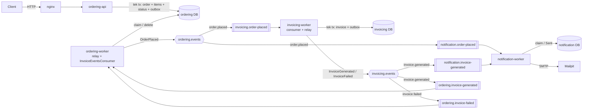
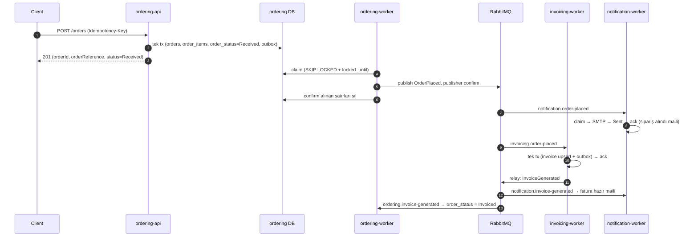
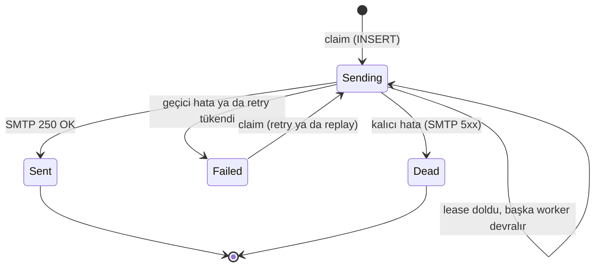

# Sipariş Yönetimi ve Asenkron İşleme: Tasarım Dokümanı

> Bu doküman kodla birlikte güncellenir. Güncel durum için en alttaki [Yol haritası](#17-yol-haritası) bölümüne bakın.

## İçindekiler

1. [Hedefler ve temel ilke](#1-hedefler-ve-temel-ilke)
2. [Mimari](#2-mimari)
3. [Uçtan uca akış](#3-uçtan-uca-akış)
4. [API](#4-api)
5. [Veri modeli](#5-veri-modeli)
6. [Event'ler ve RabbitMQ topolojisi](#6-eventler-ve-rabbitmq-topolojisi)
7. [Idempotency](#7-idempotency)
8. [Outbox ve relay](#8-outbox-ve-relay)
9. [E-posta: claim + lease state machine](#9-e-posta-claim--lease-state-machine)
10. [Fatura ve sipariş durumu](#10-fatura-ve-sipariş-durumu)
11. [Hata yönetimi](#11-hata-yönetimi)
12. [Performans ve kapasite](#12-performans-ve-kapasite)
13. [Thread-safety](#13-thread-safety)
14. [Bilinçli olarak yapmadıklarımız](#14-bilinçli-olarak-yapmadıklarımız)
15. [Bilinen sınırlar](#15-bilinen-sınırlar)
16. [Prod notları](#16-prod-notları)
17. [Yol haritası](#17-yol-haritası)

---

## 1. Hedefler ve temel ilke

| Gereksinim | Tasarımdaki karşılığı |
|---|---|
| Tepe yük 8.000 sipariş/sn | Hot path'te tek bir kısa DB transaction'ı; stateless, yatay ölçeklenen API |
| Sipariş yanıtı e-posta ve faturayı beklemez | E-posta ve fatura, transactional outbox üzerinden asenkron çalışır |
| Tekrar eden istek ikinci sipariş/e-posta/fatura üretmez | API'de `Idempotency-Key` + unique constraint; consumer'larda business key + state machine |
| Geçici hata, retry ve kalıcı başarısızlık | Hata sınıflandırması, iki katmanlı retry (exponential backoff + jitter), circuit breaker, DLQ |
| Servis kesintileri | Broker ya da SMTP çökse bile sipariş alımı devam eder; mesajlar outbox'ta ve kuyruklarda bekler |

**Temel ilke:** Sipariş isteğinin kritik yolunda **yalnızca tek bir DB transaction'ı** var. Broker'a, SMTP'ye ya da başka bir servise yapılan hiçbir çağrı bu yolda yer almıyor ve hiçbir DB transaction'ı bir dış çağrı süresince açık tutulmuyor.

## 2. Mimari



Üç bounded context ve dört deployable var. Email ayrı bir servis değil; Notification'ın bir kanalı (adapter).

| Deployable | Sorumluluk | DB | RabbitMQ | Profil |
|---|---|---|---|---|
| `ordering-api` | `POST /orders`, `GET /orders/{id}` | `ordering`: yazma + okuma | **Hiç bağlanmaz** | Latency'ye hassas, CPU |
| `ordering-worker` | Outbox relay; `InvoiceGenerated`/`InvoiceFailed` → `order_status` | `ordering`: outbox, `order_status` | Publish + consume | I/O, batch |
| `invoicing-worker` | Fatura üretimi; kendi outbox relay'i | `invoicing` | Publish + consume | CPU-ağır |
| `notification-worker` | Sipariş alındı ve fatura hazır e-postaları | `notification` | Sadece consume | I/O-bound, yüksek eşzamanlılık |

**Kurallar:**
- Her servis yalnızca kendi database'ine dokunur. Servisler arası iletişim yalnızca event'lerle yapılır; servisler arası senkron HTTP çağrısı yok.
- Event'ler **fat payload** taşır. Notification ve Invoicing, mail ve fatura için gereken her şeyi event'ten alır; Ordering DB'sine hiç gitmez.

## 3. Uçtan uca akış



İki e-posta birbirinden bağımsızdır. Sipariş maili faturayı beklemez; fatura maili ise yalnızca `InvoiceGenerated` gelince gider. İki akış paralel olduğu için fatura maili nadiren sipariş mailinden önce gidebilir; bu bilinçli olarak kabul edildi (bkz. [§15](#15-bilinen-sınırlar)).

## 4. API

### `POST /orders`

```http
POST /orders
Idempotency-Key: 7f3c2a9e-...          (zorunlu, en fazla 64 karakter)
Content-Type: application/json

{
  "customerId": "6a1e...",
  "customerEmail": "ali@example.com",
  "currency": "TRY",
  "items": [
    { "productId": "SKU-123", "productName": "Kablosuz Kulaklık", "quantity": 2, "unitPrice": 1499.90 }
  ]
}
```

| Yanıt | Durum |
|---|---|
| `201 Created` + `Location` | Yeni sipariş: `{ orderId, orderReference, status: "Received" }` |
| `200 OK` + `Idempotent-Replayed: true` | Aynı key ve aynı body ile tekrar istek: aynı sipariş, güncel durumuyla döner; yeni kayıt ya da event oluşmaz |
| `400 Bad Request` (ProblemDetails) | Validasyon hatası (alan bazında liste), bozuk JSON ya da yanlış tip (hatalı alanın JSON path'i) |
| `413 Content Too Large` | Body 64 KB'tan büyük |
| `422 Unprocessable Content` | Aynı key ile **farklı** body |
| `503 Service Unavailable` + `Retry-After` | DB'ye ulaşılamıyor. Sunucu tarafında retry yok; retry'ı client yapar, idempotency key bunu güvenli kılar |

**Validasyon** (.NET 10 built-in Minimal API validasyonu, RFC 9457 ProblemDetails):
- `items`: 1–100 kalem; aynı `productId` birden fazla kalemde olamaz
- `quantity`: 1–1000 arası tam sayı
- `unitPrice`: 0'dan büyük, en fazla 2 ondalık basamak
- `productId`, `productName`: boş olamaz, uzunluk sınırlı
- `customerEmail`: geçerli format; `currency`: 3 harfli ISO 4217 kodu
- Tip hataları: ASP.NET Core'un web varsayılanları tırnak içindeki sayıyı (`"2"`) kabul eder; bu bir client hatası olduğu için `NumberHandling = Strict` ile kapatıldı
- Request body limiti: 64 KB (Kestrel)

**Sipariş referansı:** `ORD-` + UUIDv7 id'nin Crockford Base32 gösterimi (26 karakter). DB'ye gitmeden, transaction'dan önce üretilir; tanımı gereği unique'tir ve paylaşılan state gerektirmez. DB sequence ile üretilseydi değer ancak INSERT sırasında belli olurdu, oysa aynı transaction'daki outbox payload'ı ondan önce serialize ediliyor.

### `GET /orders/{id}`

Sipariş detayı ve durumu: `orders` + `order_items` + `order_status`, PK üzerinden join, `AsNoTracking`. Sadece `ordering` DB'sini okur.

## 5. Veri modeli

Tek PostgreSQL instance'ı (lokal), **servis başına ayrı database ve ayrı login role**. Her role yalnızca kendi database'inin sahibi; `CONNECT` yetkisi PUBLIC'ten alınmış. Böylece bir servis başka bir servisin database'ine bağlantı bile açamaz ([`deploy/postgres/init/01-databases.sql`](deploy/postgres/init/01-databases.sql)). Para alanları `numeric(18,2)`, C# tarafında `decimal`.

### `ordering`

| Tablo | Önemli alanlar | Kısıt / not |
|---|---|---|
| `orders` | `id` (UUIDv7), `reference`, `customer_id`, `customer_email`, `currency`, `total_amount`, `idempotency_key`, `request_hash`, `created_at` | UNIQUE `(customer_id, idempotency_key)`. **Immutable**: sadece INSERT |
| `order_items` | `order_id`, `line_no`, `product_id`, `product_name`, `quantity`, `unit_price` | PK `(order_id, line_no)`. Immutable snapshot |
| `order_status` | `order_id` (PK, FK), `status`, `updated_at` | İlk kaydı API yazar, sonraki geçişleri ordering-worker yapar |
| `outbox_messages` | `id` (UUIDv7, aynı zamanda RabbitMQ `MessageId`), `type` (versiyonlu, örn. `OrderPlaced.v1`), `routing_key`, `payload` (jsonb), `created_at`, `locked_until`, `attempts` | Publish edilen satır silinir. Routing key satırda tutulduğu için relay generic kalır |

Durum ayrı bir tabloda, çünkü PostgreSQL'de UPDATE satırın tamamının yeni bir kopyasını yazar (MVCC). Saniyede binlerce durum güncellemesi geniş `orders` satırları yerine dar `order_status` satırlarına gidiyor: daha az WAL, daha az bloat, `orders` tablosu üzerinde neredeyse hiç vacuum baskısı yok.

### `invoicing`

| Tablo | Önemli alanlar | Kısıt / not |
|---|---|---|
| `invoices` | `id`, `order_id`, `order_reference`, `invoice_number`, `status` (`Generated`/`Failed`), `total_amount`, `currency`, `customer_email`, `lines` (jsonb snapshot), `failure_reason`, `created_at`, `updated_at` | UNIQUE `order_id`. `invoice_number` yalnızca `Generated` kayıtta dolu |
| `outbox_messages` | Ordering'dekiyle aynı yapı | |

### `notification`

| Tablo | Önemli alanlar | Kısıt / not |
|---|---|---|
| `notifications` | `id`, `order_id`, `type` (`OrderReceived`/`InvoiceReady`), `recipient`, `status` (`Sending`/`Sent`/`Failed`/`Dead`), `lease_id`, `locked_until`, `attempts`, `last_error`, `sent_at` | UNIQUE `(order_id, type)` |

## 6. Event'ler ve RabbitMQ topolojisi

| Event | Üreten | Payload | Tüketen |
|---|---|---|---|
| `OrderPlaced` v1 | Ordering (outbox) | `orderId, orderReference, customerId, customerEmail, currency, totalAmount, items[{productId, productName, quantity, unitPrice}], createdAt` | Invoicing, Notification |
| `InvoiceGenerated` v1 | Invoicing (outbox) | `invoiceId, invoiceNumber, orderId, orderReference, customerEmail, currency, totalAmount, issuedAt` | Notification, Ordering |
| `InvoiceFailed` v1 | Invoicing (outbox) | `orderId, orderReference, reason` | Ordering |

Mesaj property'leri: `MessageId` (outbox satır id'si), `Type`, `ContentType=application/json`, `traceparent` header'ı.

| Exchange (topic) | Routing key | Queue | Consumer |
|---|---|---|---|
| `ordering.events` | `order.placed` | `invoicing.order-placed` | invoicing-worker |
| `ordering.events` | `order.placed` | `notification.order-placed` | notification-worker |
| `invoicing.events` | `invoice.generated` | `notification.invoice-generated` | notification-worker |
| `invoicing.events` | `invoice.generated` | `ordering.invoice-generated` | ordering-worker |
| `invoicing.events` | `invoice.failed` | `ordering.invoice-failed` | ordering-worker |

Her kuyruk **tek bir mesaj tipi** taşır; consumer beklemediği tipi DLQ'ya gönderir. Bu yüzden Ordering için `invoice.*` ile tek bir kuyruk yerine iki ayrı kuyruk var. Faydası: bir DLQ her zaman tek tip mesaj içerir ve replay basit kalır.

Her consumer kuyruğunun yanında aşağıdaki kuyruk seti var. Tümü quorum queue.

**Topolojinin tamamını her servis declare eder** (tek tanım: [`Contracts/MessagingTopology.cs`](src/Contracts/MessagingTopology.cs), açılışta idempotent). Klasik "her consumer kendi kuyruğunu declare eder" yaklaşımında taze bir ortamda bir yarış oluşur. `mandatory=true` mesajın yalnızca *en az bir* kuyruğa ulaşmasını garanti eder. Notification kuyruğu varken Invoicing henüz başlamamışsa, o arada yayınlanan siparişler Invoicing'e **sessizce hiç ulaşmaz**. Relay ise ilk publish'ten önce topolojinin tamamını kurduğu için bu pencere hiç oluşmaz.

```
<queue>                 ana kuyruk. DLX → <queue>.dlq, x-delivery-limit=10
<queue>.retry.5s        ┐ consumer'ı YOK; x-message-ttl dolunca DLX ile ana kuyruğa döner
<queue>.retry.30s       │ x-dead-letter-strategy=at-least-once + x-overflow=reject-publish
<queue>.retry.2m        │ (quorum queue'da varsayılan dead-lettering at-most-once'tır;
<queue>.retry.10m       ┘  retry yolunda mesaj kaybetmemek için at-least-once seçildi)
<queue>.dlq             son durak: retry'ı tükenen ve kalıcı hatalı mesajlar
```

- `x-delivery-limit`, process'i hatayı sınıflandırmaya fırsat bulamadan çökerten mesajlara karşı bir güvenlik ağı (crash loop).
- Retry seviyelerinde **mesaj başına TTL değil, kuyruk başına sabit TTL** kullanılıyor. RabbitMQ'da mesaj başına TTL yalnızca mesaj kuyruğun başına geldiğinde değerlendiriliyor; uzun TTL'li bir mesaj arkasındakileri bekletirdi.
- Publish işlemleri **publisher confirm** ve `mandatory=true` ile yapılıyor. Hiçbir kuyruğa yönlendirilemeyen mesaj sessizce kaybolmaz, publisher'a geri döner.

## 7. Idempotency

| Katman | Tekrar nedeni | Çözüm |
|---|---|---|
| API | Client'ın timeout sonrası retry'ı, çift tıklama | `Idempotency-Key` + UNIQUE `(customer_id, idempotency_key)` |
| Outbox → broker | Relay'in lease süresi dolması, kaybolan confirm | Bilinçli olarak at-least-once |
| Consumer | Duplicate mesaj, redelivery, DLQ replay | Business key üzerinde unique constraint + state machine |

**API akışı:** Önce kontrol edip sonra insert etmek yerine (race condition'a açık) doğrudan insert ediyoruz. Unique index kontrolü insert'in parçası olduğu için normal akışta ek maliyet yok.

1. Body'nin SHA-256 fingerprint'i hesaplanır.
2. `orders` + `order_items` + `order_status` + `outbox_messages` tek `SaveChangesAsync` ile yazılır.
3. Constraint'ten `23505` gelirse: `ChangeTracker.Clear()` → mevcut sipariş okunur → hash aynıysa `200` + aynı body, farklıysa `422`.

Aynı key ile iki istek aynı anda gelirse ikinci INSERT, birincinin commit'ini unique index üzerinde **bekler** (~ms), ardından `23505` alır. Redis gerekmiyor (bkz. [§14](#14-bilinçli-olarak-yapmadıklarımız)).

Siparişle outbox kaydı aynı transaction'da yazıldığı için tekrar eden istek **ikinci bir outbox kaydı üretmez**. Tekillik kaynakta garanti altında. Transport katmanı ise doğası gereği tekrar üretebilir; bu yüzden her consumer idempotent:

| Consumer | Business key | Tekrar gelince |
|---|---|---|
| Fatura | `invoices.order_id` UNIQUE | Koşullu upsert 0 satır döner → event yok, ack |
| E-posta | `notifications (order_id, type)` UNIQUE | Claim alınamaz → `Sent`/`Dead` ise ack, değilse gecikmeli tekrar |
| Sipariş durumu | Koşullu UPDATE | 0 satır → zararsız, ack |

Generic bir inbox tablosu yerine business key kullanılmasının nedeni: DLQ'dan replay edilen ya da bir bug yüzünden yeniden üretilen event farklı bir message id taşıyabilir; business key her durumda yakalar.

## 8. Outbox ve relay

Dual-write problemi: DB commit'i ile broker publish'i tek transaction'a sokulamaz. Outbox bunu "gönderilecek mesaj" bilgisini siparişle **aynı transaction'da** DB'ye yazarak çözer. Relay, her outbox'ı olan serviste çalışan bir `BackgroundService`'tir (`OutboxRelayService`, BuildingBlocks); kod ortak, connection string ve exchange servise özel.

```sql
WITH claimable AS MATERIALIZED (
    SELECT id FROM outbox_messages
    WHERE locked_until IS NULL OR locked_until < now()
    ORDER BY id
    LIMIT @batch_size
    FOR UPDATE SKIP LOCKED
)
UPDATE outbox_messages o
SET    locked_until = now() + @lease_duration, attempts = o.attempts + 1
FROM   claimable c
WHERE  o.id = c.id
RETURNING o.id, o.type, o.payload;
```

1. **Claim** (milisaniyelik tx): 500 satır seçilir, `locked_until = now() + 30 s` yazılır, commit edilir. DB kilidi commit ile kalkar; geriye mantıksal kilit (lease) kalır.
2. **Publish** (transaction dışında): batch gönderilir, publisher confirm'leri toplu beklenir.
3. **Delete**: sadece ACK alınan satırlar tek sorguda silinir. Bu adım iptal edilemez; shutdown sırasında bile tamamlanır, çünkü atlamak sadece mükerrer mesaj üretir.
4. **Hata durumunda**:
   - Broker NACK verdiyse ya da mesaj yönlendirilemediyse (`basic.return`): satır lease'ini korur ve lease dolunca tekrar denenir. Hemen tekrar denemek aynı hatayı üretip log'u doldururdu.
   - Kanal ya da bağlantı hatası (broker çökmüş, timeout): confirm alınamayan satırların lease'i **hemen bırakılır**. Aksi hâlde sonraki turlar claim edilecek satır bulamaz ve "başarılı" sayılır; circuit breaker kesintiyi hiç görmez. Ayrıca broker geri geldiğinde mesajlar lease bitene kadar (30 sn) bekler.

Relay DbContext kullanmaz: claim, delete ve release komutları [`OutboxStore`](src/BuildingBlocks/BuildingBlocks/Outbox/OutboxStore.cs) içinde doğrudan Npgsql ile, parametreli (`$1`, `$2`) olarak çalışır. Publish batch'inin timeout'u (20 sn), lease süresinden (30 sn) kısa olmak zorunda; aksi hâlde başka bir relay hâlâ yayınlanan bir batch'i devralabilir. Bu kural açılışta doğrulanıyor (`ValidateOnStart`).

Notlar:
- `SKIP LOCKED` birden fazla relay'in (pod) aynı anda **farklı satırlarla paralel** çalışmasını sağlar. ShedLock benzeri tek-lider yaklaşımından daha iyi ölçeklenir.
- `AS MATERIALIZED`, subquery'nin tam bir kez değerlendirilmesini garanti eder. `WHERE id IN (subquery … LIMIT … FOR UPDATE SKIP LOCKED)` biçiminde, eşzamanlı güncellemeler altında subquery'nin yeniden değerlendirilip LIMIT'ten fazla satırın claim edilmesi riski var.
- Silme işleminde lease kontrolü yok: confirm alınmış bir mesajı hangi relay silerse silsin doğrudur, çünkü mesaj teslim edilmiştir.
- Relay'i uyandırmak için `LISTEN/NOTIFY` **kullanılmıyor**: `NOTIFY` commit sırasında global bir kilit alır ve yüksek TPS'te commit'leri serileştirir. Bunun yerine adaptive polling var: kayıt yoksa 50 ms'den 1 sn'ye backoff, kayıt varsa beklemeden tekrar dönülür.
- Relay crash'inde aynı mesaj tekrar publish edilebilir (at-least-once); consumer'lar idempotent.
- Broker çökerse API etkilenmez; mesajlar outbox'ta birikir ve broker dönünce boşalır.

## 9. E-posta: claim + lease state machine

SMTP bir DB transaction'ına dahil edilemez ve gönderilmiş bir mail geri alınamaz. Bu yüzden önce sahiplenme (claim), sonra transaction dışında gönderim, sonra işaretleme yapılıyor.



```sql
INSERT INTO notifications (id, order_id, type, recipient, status, lease_id, locked_until, attempts, ...)
VALUES (@id, @order_id, @type, @recipient, 'Sending', @lease_id, now() + @lease_duration, 1, ...)
ON CONFLICT (order_id, type) DO UPDATE
SET    status = 'Sending', lease_id = EXCLUDED.lease_id,
       locked_until = EXCLUDED.locked_until, attempts = notifications.attempts + 1, updated_at = now()
WHERE  notifications.status = 'Failed'
   OR (notifications.status = 'Sending' AND notifications.locked_until < now());
```

| Adım | Ayrıntı |
|---|---|
| 1. Claim (kısa tx) | Etkilenen satır 1 → iş bende. 0 → mevcut duruma bakılır: `Sent`/`Dead` → ack; diğer her durum → delay kuyruğu (**ack edilmez**; diğer worker gönderemeden ölmüş olabilir) |
| 2. Gönderim (tx dışında) | SMTP timeout 10 sn, Polly retry + circuit breaker. `Message-ID` deterministik: `<order-{id}-{type}@…>` |
| 3. İşaretleme (kısa tx) | `UPDATE … SET status='Sent' WHERE … AND lease_id = @lease_id`. Lease'i kaybetmiş eski sahip, başkasının kaydının üzerine yazamaz (fencing). Bu update'in **kendi** kısa retry'ı var; SMTP bu yüzden asla tekrar çağrılmaz. Retry'lar da başarısız olursa mesaj yine ack edilir ve hata loglanır: mail zaten gitti, ack etmemek kesin bir mükerrer mail demek |

- **Lease:** 60 sn. SMTP timeout'u ve in-process retry'ları kapsar. Tüm zaman karşılaştırmaları DB'nin `now()`'ı ile yapılır; pod saatleri arasındaki fark (clock skew) sorun olmaz.
- **`Dead` yalnızca kalıcı hatalar için.** Retry'ı tükenen mail `Failed` olarak kalır ve DLQ'ya gider. Böylece DLQ'dan replay edilen mesaj claim'i tekrar alabilir. Retry'ın tükenip tükenmediğine mesajdaki `x-retry-count` karar verir; DB'deki `attempts` yalnızca bilgi amaçlı.
- **Sınır:** SMTP "250 OK" ile `Sent` işaretlemesi arasındaki milisaniyelik pencerede crash olursa mail iki kez gidebilir (at-least-once). Harici bir sistemle exactly-once mümkün değil. Redis gibi ikinci bir kayıt deposu bu pencereyi kapatmaz, sadece yerini değiştirir. Prod'da idempotency key destekleyen bir e-posta sağlayıcısıyla pencere tamamen kapanır.

## 10. Fatura ve sipariş durumu

Faturada etki DB içinde kaldığı için mükerrer kontrolü ve iş **aynı transaction'da** atomik olarak yapılabiliyor; claim veya lease gerekmiyor.

1. Ucuz ön kontrol: `invoices` tablosunda `Generated` kayıt varsa ack edilir. Bu sadece optimizasyon; garanti constraint'ten gelir.
2. Fatura içeriği üretilir (CPU işi, transaction dışında).
3. Tek kısa tx: koşullu upsert + outbox'a `InvoiceGenerated`.

```sql
INSERT INTO invoices (id, order_id, ..., status, invoice_number, ...)
VALUES (@id, @order_id, ..., 'Generated', nextval('invoice_number_seq'), ...)
ON CONFLICT (order_id) DO UPDATE
SET    status = 'Generated', invoice_number = EXCLUDED.invoice_number,
       failure_reason = NULL, updated_at = now()
WHERE  invoices.status = 'Failed'          -- yalnızca Failed kayıt onarılabilir
RETURNING id, invoice_number, issued_at;
```

`SqlQuery<IssuedInvoice>` bu sonucu bir record'a eşler. Snake_case naming convention EF'nin ad-hoc tiplerine de uygulandığı için kolonlar alias'sız, `invoice_number` gibi adlarıyla dönmeli; `AS "InvoiceNumber"` yazılsaydı eşleme bozulurdu. Sorgu ayrıca compose edilmemeli: `FirstOrDefault` eklenirse EF `INSERT … RETURNING`'i bir sub-select'e sarar ve PostgreSQL bunu reddeder. Bu yüzden `ToListAsync` kullanılıyor.

- Satır dönerse fatura ilk kez üretilmiş ya da `Failed` kayıt onarılmıştır; outbox'a `InvoiceGenerated` yazılır. Satır dönmezse mükerrer mesajdır; event yazılmaz.
- Kalıcı hatada: `INSERT … 'Failed' … ON CONFLICT (order_id) DO NOTHING`. Etkilenen satır 1 ise `InvoiceFailed` yazılır ve mesaj DLQ'ya gider. `Generated` bir kayıt asla `Failed`'a düşürülmez.
- Fatura numarası `INV-` + sequence. `nextval` conflict kontrolünden önce çalıştığı ve rollback'te geri alınmadığı için numaralarda boşluk olabilir; ön kontrol bunu azaltır. Boşluksuz numaralandırma case kapsamında değil.

**`order_status` geçişleri** (ordering-worker, koşullu `ExecuteUpdateAsync`):

| Gelen event | İzin verilen mevcut durum | Yeni durum |
|---|---|---|
| `InvoiceGenerated` | `Received`, `InvoiceFailed` | `Invoiced` |
| `InvoiceFailed` | `Received` | `InvoiceFailed` |
| — | `Invoiced` | Son durum; hiçbir event değiştiremez |

Event'ler hangi sırayla gelirse gelsin sonuç aynı: replay sonrası `InvoiceFailed` ve `InvoiceGenerated` ikisi de kuyruktaysa, her iki sıralamada da durum `Invoiced` olur.

**Eşzamanlılık:** Aynı anahtar için eşzamanlı iki yazma geldiğinde PostgreSQL ikinciyi birincinin commit'ine kadar bekletir, ardından conflict'i ve `WHERE` koşulunu satırın en güncel versiyonuna göre yeniden değerlendirir. Uygulama tarafında kilit gerekmiyor.

**Raw SQL yüzeyi bilinçli olarak dar tutuldu:** Yalnızca EF Core'un ifade edemediği yerler raw SQL ve her biri kendi sınıfında toplu duruyor:
- Outbox claim, delete ve release: `OutboxStore`, doğrudan Npgsql, `$1` parametreleri
- Fatura upsert ve hata kaydı: `InvoiceRepository`, EF `ExecuteSqlAsync` / `SqlQuery`
- Mail claim: `NotificationRepository`, EF `ExecuteSqlAsync`

Tamamı parametreli (EF tarafında EF1002 build hatası) ve transaction kapsamlı. Advisory lock, `LISTEN` ya da `SET` gibi session-level özellik yok; PgBouncer transaction mode ile uyumlu. Geri kalan her şey tipli EF (`SaveChangesAsync`, `ExecuteUpdateAsync`, `ExecuteDeleteAsync`).

## 11. Hata yönetimi

### Sınıflandırma

| Sınıf | Örnekler | Davranış |
|---|---|---|
| Geçici | Timeout, connection refused, SMTP 4xx, PG `40001`/`40P01`/`53300`, broker'a ulaşılamaması | Retry |
| Kalıcı | Deserialize hatası (poison), bilinmeyen event versiyonu, business/validasyon hatası, SMTP 5xx | Retry yok, doğrudan DLQ |
| Hata değil | Mükerrer kayıt (unique violation / claim alınamaması) | Başarı say, ack |
| Bilinmeyen exception | — | Geçici say; deneme sayısı sınırlı |

Kendi worker pod'umuzun ölmesi retry konusu değil: ack edilmemiş mesajı RabbitMQ başka bir consumer'a kendiliğinden yeniden teslim eder.

### Retry (exponential backoff + jitter)

| Katman | Ayar | Amaç |
|---|---|---|
| In-process (Polly v8) | 3 deneme, ~200 → 400 → 800 ms, jitter | Anlık kesintiler. Kısa tutuluyor, çünkü bu süre boyunca mesaj consumer'ın eşzamanlılık slotunu meşgul ediyor |
| Broker | `retry.5s` → `retry.30s` → `retry.2m` → `retry.10m` → DLQ | Uzun kesintiler. Deneme sayısı `x-retry-count` header'ında |

**API'nin hot path'inde retry yok.** Kesinti anında sunucu tarafı retry yükü katlar (retry storm). DB'ye ulaşılamıyorsa kısa timeout ile `503` dönülür.

### Circuit breaker

Polly pipeline sırası, dıştan içe: toplam timeout → retry → circuit breaker → deneme başına timeout. Pipeline'lar **singleton**; mesaj başına oluşturulsalardı breaker'ın durumu her seferinde sıfırlanırdı.

| Nerede | Açıkken |
|---|---|
| SMTP (notification-worker) | **Consumer duraklatılır**; mesajlar ana kuyrukta bekler, half-open'da devam edilir. Mesajları retry kuyruklarında döndürmek hem CPU harcar hem retry bütçesini boşa tüketirdi. Breaker'ı yalnızca geçici hatalar (4xx, timeout, bağlantı) tetikler: geçersiz bir alıcı (550) sunucunun sağlığı hakkında bilgi vermez; breaker'ı açıp diğer bütün mailleri durdurmamalı |
| RabbitMQ publish (relay'ler) | Relay durur, mesajlar outbox'ta birikir; API etkilenmez |
| Fatura üretici (simüle dış servis) | Consumer duraklatılır |

### Consumer pipeline

Ortak consumer altyapısı ([`RabbitMqConsumerService`](src/BuildingBlocks/BuildingBlocks.Messaging/Consuming/RabbitMqConsumerService.cs)) her teslimatı tam olarak bir sonuca bağlar. Retry ya da DLQ kopyası broker'dan confirm alınmadan orijinal mesaj ack edilmez; bu yüzden arada bir crash olursa mesaj en fazla tekrar eder, kaybolmaz.

| Handler'ın sonucu | Consumer'ın yaptığı |
|---|---|
| Normal dönüş | ack |
| Bozuk JSON, bilinmeyen tip/versiyon, `PermanentMessageException` | DLQ (`Permanent`) |
| `DeferMessageException` (iş başka bir worker'da) | Gecikmeli retry seviyesi; **retry bütçesi tüketilmez** |
| Bağımlılığın circuit'i açık (`BrokenCircuitException`) | 5 sn seviyesi, bütçe tüketilmez, ve consumer breaker'ın `RetryAfter` süresi kadar **duraklatılır** |
| Diğer her şey | Sonraki retry seviyesi; seviyeler bitince `OnRetriesExhaustedAsync` çağrılır, ardından DLQ (`RetryExhausted`) |
| Retry/DLQ kopyası yayınlanamadı | `nack` + requeue |

Kapanışta consumer önce yeni mesaj almayı keser, işlenmekte olanlara 10 sn tanır, ancak süre dolunca onları iptal eder. Ack edilmemiş mesajlar kanal kapanınca kuyruğa döner.

### DLQ ve replay

- Her consumer kuyruğunun **kendi** DLQ'su var. Böylece replay yalnızca hata alan consumer'a gider; global bir DLQ'dan replay mesajı tüm consumer'lara yeniden dağıtırdı.
- Header'lar: `x-failure-type` (`RetryExhausted`/`Permanent`), orijinal kuyruk, exception tipi ve mesajı, ilk hata zamanı, `x-final-retry-count`.
- Mesaj DLQ'ya gönderilirken `x-retry-count` kaldırılır. Replay edilen mesaj sıfırdan başlar; yoksa ilk hatada tekrar DLQ'ya düşerdi.
- **Replay:** RabbitMQ Management UI → ilgili `.dlq` → *Move messages* ile ana kuyruğa taşıma. Bu özellik shovel plugin'ini kullanır; compose'da etkin ([`deploy/rabbitmq/enabled_plugins`](deploy/rabbitmq/enabled_plugins)). Idempotency sayesinde replay güvenli. Uçtan uca denendi: desteklenmeyen para birimi yüzünden `Failed` olan bir fatura, destek eklenip mesaj DLQ'dan taşındığında **aynı fatura id'siyle** `Generated` oldu, sipariş `InvoiceFailed`'dan `Invoiced`'a geçti ve fatura maili gitti.
- İş durumu da güncelleniyor (`notifications.status`, `invoices.status` + `InvoiceFailed` → `order_status`); kayıt yalnızca DLQ'ya bırakılmıyor.

### Fallback'ler: bilinçli olarak az

| Nerede | Fallback | Gerekçe |
|---|---|---|
| API, DB yok | Yok, `503` + `Retry-After` | Siparişi kalıcı bir yere yazmadan "aldım" demek veri kaybı riski demek |
| SMTP yok | Breaker + gecikmeli retry | Alternatif sağlayıcı kapsam dışında |
| Broker yok | Outbox (tasarımın kendisi) | — |
| GET, DB yok | Yok, `503` | Cache yok; bayat veri göstermek yerine hata |

## 12. Performans ve kapasite

**Darboğaz API CPU'su değil, DB commit hızı.** İstek başına ~0.2–0.4 ms CPU harcanıyor; 8k/sn için ~3 core yeterli. DB tarafında Little's Law ile hesap: `8.000 tx/sn × ~3 ms ≈ 24` eşzamanlı connection; burst payıyla ~50 yeterli. Pool'u büyütmek hızlandırmaz, contention'ı artırır.

| Bileşen | Ayar |
|---|---|
| Npgsql pool (pod başına) | ordering-api 20, ordering-worker 5, invoicing 8, notification 8. Connection `Timeout` kısa (~2 sn) |
| PgBouncer (transaction mode) | Database başına server pool: ordering 40, invoicing 15, notification 15. `query_wait_timeout = 5 s` |
| PostgreSQL role'leri | `CONNECTION LIMIT`: pool'ların arkasında ikinci bir bulkhead |
| Load shedding | ASP.NET Core concurrency limiter; aşırı yükte istekler sonsuz kuyruğa alınmak yerine hızla `503` alır |
| Hot path | Tek `SaveChangesAsync` (EF batching ile tek round-trip), UUIDv7 (B-tree'de sıralı ekleme), `AddDbContextPool`, System.Text.Json source generation |
| Dayanıklılık | `synchronous_commit = on`: onaylanan sipariş crash'te kaybolmaz; throughput için durability'den taviz verilmiyor |

**Pod sayısı:** API tepe yükü karşılamak zorunda: `N = ceil(8000 / (pod_kapasitesi × 0.7)) + 1`. 2 vCPU'luk pod'larla ilk tahmin 4; kesin sayı k6 ölçümüyle belirlenir. Worker'lar ise tepe yüke yetişmek zorunda değil: kampanya anında mesajlar kuyrukta birikir, worker'lar kendi hızlarında eritir. Worker'lar **ortalama yük ve kabul edilebilir gecikmeye** göre boyutlandırılır ve kuyruk derinliğine göre ölçeklenir. Lokalde her servisten 2 replica çalışır; amaç kapasite değil, eşzamanlılık tasarımının (SKIP LOCKED, lease, competing consumers) gerçekten çalıştığını göstermek.

**Write amplification ve batching:** Mesaj başına işlemede arka plan, API'den daha fazla commit üretiyor (e-posta başına claim + `Sent`). İlk sürüm consumer'larda **mesaj başına** işleme yapıyor: her mesaj kendi scope'unda, paylaşılan state yok, `Sent` işaretlemesi beklemeden yapılıyor. **Consumer micro-batching'i zorunlu bir sonraki adım** (bkz. [§17](#17-yol-haritası)): claim ve işaretleme toplu yapılıp ack'ler toplu gönderilecek; iki sürüm k6 ile ölçülüp karşılaştırılacak. Relay zaten batch çalışıyor (500'lük claim, toplu confirm, toplu delete).

## 13. Thread-safety

| Bileşen | Thread-safe mi? | Kural |
|---|---|---|
| `DbContext` | ❌ | API'de request scope (`AddDbContextPool`); worker'da mesaj başına `IDbContextFactory`. Aynı context üzerinde paralel `await` yok, singleton'da tutulmaz |
| `NpgsqlDataSource` | ✔ | Process başına tek instance |
| RabbitMQ `IConnection` | ✔ | Process başına uzun ömürlü. **Publish ve consume için ayrı connection**: broker publisher'ı yavaşlattığında (flow control) consumer ack'leri bloklanmaz |
| RabbitMQ `IChannel` | ⚠️ | Her consumer'ın ve her relay'in kendi kanalı var. **Ack'ler:** `ConsumerDispatchConcurrency` ile eşzamanlı çalışan handler'lar ack'i kendi consumer kanallarından gönderir; bu özellik tam olarak bu kullanım için var. **Retry/DLQ publish'leri:** client, bir kanalın eşzamanlı kullanımını belgelemediği için tek kanal üzerinden `SemaphoreSlim` ile sıralı yapılır. Bu yol yalnızca hata durumunda kullanıldığı için maliyeti ihmal edilebilir |
| Delivery body | — | Yalnızca handler çalışırken geçerli (client belgesi). Retry/DLQ kopyası handler dönmeden yayınlanıyor |
| MailKit `SmtpClient` | ❌ | Aynı anda tek gönderim yapabilir. Eşzamanlılık kadar client içeren bounded bir pool var: client havuzdan alınır, kullanılır, geri konur. Gönderim ortasında hata alan client tekrar kullanılmaz, atılır |
| Polly `ResiliencePipeline` | ✔ | Singleton |
| `JsonSerializerOptions` / source-gen context | ✔ | Tek instance |
| `ValueTask` | — | Tam bir kez `await` edilir; saklanacaksa önce `.AsTask()`. Relay'in batch publish listesinde CA2012 bunu build'de yakaladı |
| Paylaşılan referanslar (lazy bağlantı vb.) | — | Kilitsiz okuma yolunda `Volatile.Read/Write`; ARM64'ün bellek modeli x64 kadar sıkı değil |
| Sayaçlar / random | — | `Interlocked` / OpenTelemetry Meter; `Random.Shared` |
| Kilitler | — | `lock` içinde `await` yok; async kilit için `SemaphoreSlim.WaitAsync` |

Derleyici bunların bir kısmını zorunlu kılıyor ([`.editorconfig`](.editorconfig), build hatası seviyesinde):
- **CA1849:** Async metot içinde sync çağrı (sync-over-async → ThreadPool starvation)
- **CA2012:** `ValueTask`'ın yanlış kullanımı
- **CA2016:** `CancellationToken`'ın iletilmemesi
- **EF1002:** Raw SQL'de interpolation ile injection riski

## 14. Bilinçli olarak yapmadıklarımız

| Seçenek | Neden yok |
|---|---|
| Idempotency için Redis | DB transaction'ıyla atomik değil; failover ve eviction'da key kaybı mükerrer kayıt demek. Garanti zaten DB'den gelmek zorunda. Normal akışta her isteğe ek bir round-trip ve yeni bir failure point ekler |
| GET için cache | PK ile okuma sub-ms; invalidation riski getirir |
| Kafka | İş yükü bir task queue: bağımsız, yavaş, mesaj başına retry gerektiren işler. Partition içi sıralı işleme ve head-of-line blocking, yavaş I/O işleri için ek karmaşıklık getirir. Replay ya da key bazlı sıralama ihtiyacı yok. 8–24k msg/sn RabbitMQ quorum queue kapasitesinin içinde |
| MassTransit / MediatR | v9 / güncel sürümler ticari lisanslı; ayrıca outbox ve retry mekanizmasının kontrolü bizde olsun istedik |
| `LISTEN/NOTIFY` | Commit sırasında global kilit; yüksek TPS'te commit'leri serileştirir |
| EF Core `EnableRetryOnFailure` | Açık transaction'larla çakışır; retry mesaj işleme birimi seviyesinde yapılıyor |
| `TransactionScope` / dağıtık transaction | Gerek yok; tek DB'de tek `SaveChangesAsync` zaten atomik |
| Servisler arası senkron HTTP | Coupling ve zincirleme kesinti riski; tüm iletişim event'lerle |
| Debezium (CDC) | Daha az DB yükü getirir ama Kafka Connect altyapısı gerektirir; polling relay case ölçeği için yeterli |

## 15. Bilinen sınırlar

- **E-posta at-least-once:** SMTP OK ile `Sent` işaretlemesi arasındaki milisaniyelik pencerede crash olursa mail iki kez gidebilir ([§9](#9-e-posta-claim--lease-state-machine)).
- **Mail sırası:** Fatura maili nadiren sipariş mailinden önce gidebilir; iki akış bağımsız ve paralel.
- **Birim fiyat client'tan geliyor:** Case gereği böyle. Gerçek bir sistemde fiyat katalog servisinden alınırdı.
- **Auth yok:** `customerId` ve `customerEmail` request'te geliyor.
- **Fatura numaralarında boşluk** olabilir.
- **Lokal ölçümler gösterge niteliğinde:** k6 ve tüm container'lar aynı makinenin CPU'sunu paylaşıyor.

## 16. Prod notları

- **Secret'lar ve ortamlar:** Repodaki şifreler yalnızca lokal içindir. Prod'da secret store'dan ortam değişkeni olarak enjekte edilir; servis kullanıcıları en az yetkiyle (yalnızca kendi database'i) çalışır, iletişim TLS üzerinden olur.
- **Ayrı PostgreSQL instance'ları:** Aynı instance'taki database'ler WAL, fsync, shared_buffers ve checkpoint'leri paylaşır. En azından `ordering` ayrı bir instance'ta olmalı; arka plan yazma yükü siparişin hot path'ini etkilememeli.
- **Outbox tablosunun bakımı:** Yüksek hacimde silme dead tuple üretir. Tablo bazında autovacuum ayarı ya da zamana göre partitioning + partition drop.
- **PgBouncer:** Tek thread'li. Birden fazla instance ya da çok thread'li bir alternatif (PgCat).
- **Ölçekleme:** API için CPU/RPS bazlı HPA; worker'lar için kuyruk derinliği bazlı KEDA (RabbitMQ scaler).
- **RabbitMQ:** 3 node'luk cluster; quorum queue'lar Raft ile replike olur.
- **E-posta sağlayıcısı:** Idempotency key destekleyen bir sağlayıcı; at-least-once penceresini kapatır.
- **Bağımlılık güvenliği:** NuGet audit build'de açık. Transitive bir açık (örneğin MimeKit'in getirdiği `System.Security.Cryptography.Pkcs` 10.0.0'daki CVE-2026-84008) central package management ile yamalı sürüme sabitlendi; `dotnet list package --vulnerable --include-transitive` temiz. Prod'da CI'da aynı kontrol zorunlu olmalı.
- **Gözlemlenebilirlik:** OpenTelemetry trace'leri (`traceparent` mesaj header'ında taşınır), DLQ derinliği ve outbox'ta bekleyen satır sayısı için alarm.

## 17. Yol haritası

Her aşamanın sonunda birlikte gözden geçirme yapılıyor.

- [x] **0.** `DESIGN.md`, solution iskeleti, docker-compose (PostgreSQL, PgBouncer, RabbitMQ, Mailpit)
- [x] **1.** Ordering.Api: model, migration'lar, `POST`/`GET`, idempotency, outbox yazımı, validasyon, Swagger, minimal integration test
- [x] **2.** BuildingBlocks + Ordering.Worker: outbox relay, RabbitMQ topolojisi, publisher confirms
- [x] **3.** Notification.Worker: claim/lease, MailKit + Mailpit, retry/DLQ/circuit breaker
- [x] **4.** Invoicing.Worker (upsert, kendi outbox'ı ve relay'i) + Ordering.Worker'daki fatura durumu consumer'ları
- [ ] **5.** Consumer micro-batching (zorunlu)
- [ ] **6.** nginx + replica'lar, k6 (mesaj başına ve batch karşılaştırması), README ve prod notları
